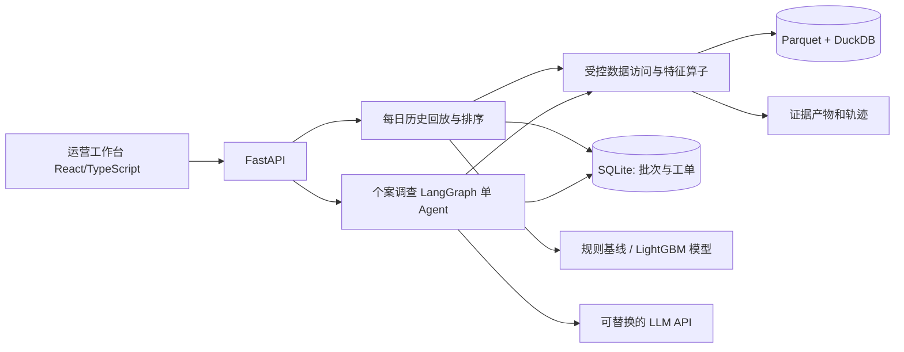
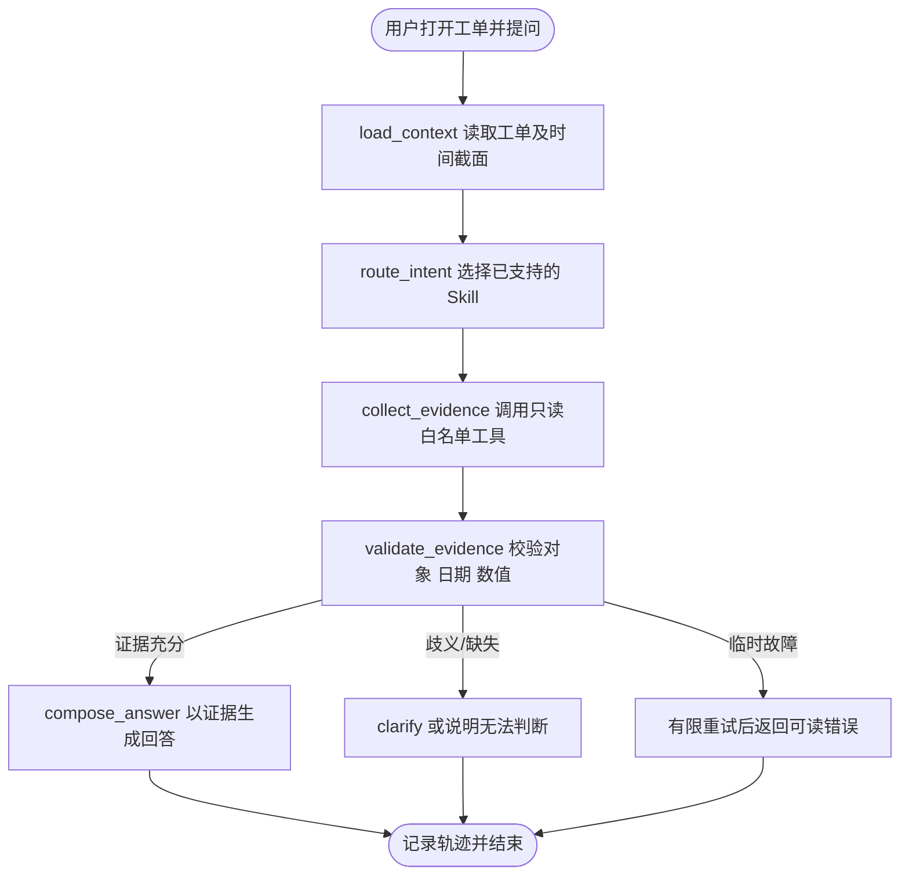

# StockWatch Agent：生鲜零售缺货巡检工作台技术设计

**版本**：V0.1（设计草案）  
**日期**：2026-11-08  
**性质**：基于公开历史数据的个人作品；本文为实施设计，非已建成系统  
**目标读者**：开发者、项目评审者、后续协作者

## 1. 摘要

StockWatch Agent 面向负责多门店、多商品的零售运营人员。系统按历史日期回放，在每日结束时使用当日及以前的数据，对次日门店—商品的缺货风险进行排序；用户在工作台查看候选对象，并可向 Agent 追问历史缺货证据、模型信息和数据局限。人工可记录巡检状态。

系统由两条独立链路构成：**批处理排序**由数据流水线和统计/机器学习模型实现；**个案调查**由 LangGraph 单 Agent 调用受控工具实现。风险模型、Agent 答复和人工交互分别评测。专用工作台优于通用 Agent 或普通报表只是待验证假设。

## 2. 范围与成功标准

### 2.1 用户与场景

- 用户：区域运营或商品管理人员。
- 场景：每天有数量上限的人工巡检名额，需要优先查看有缺货风险的门店—商品组合。
- 粒度：`store_id × product_id × as_of_date`。
- 运行方式：单机历史回放；用户选定日期 T，假定当日数据在日终完整可用，输出 T+1 的清单。
- 人工行动：仅在本产品中记录“已查看/待核查/关闭”及备注，不触发真实业务动作。

### 2.2 V1 功能验收

1. 导入公开数据并生成数据版本、字段检查和基础质量报告；对重复键/缺失字段明确报错或隔离。
2. 任意有效回放日 T，可复现相同候选集合和排序；无 T+1 数据时只生成风险清单，评价标记为未成熟。
3. 提供近 7 天缺货频次规则基线；实现或接入一个冻结的风险模型，并按同一时间截面评测。
4. 前端展示批次、排序、个案详情、历史图表、Agent 工具轨迹和人工状态；刷新后状态仍在。
5. Agent 能回答历史统计问题、识别信息不足并给出证据；不声称真实补货数量或确定性原因。
6. 发布一套可运行的测试、时间回放说明、基线比较结果及失败案例；不预设分数或提升幅度。

### 2.3 不在 V1 范围

实时数据接入、下单或调拨、供应商沟通、真实库存量/损失金额、在线商业收益、因果归因、多用户企业级权限、多 Agent、自由执行 SQL/Python。历史回放不能证明干预后缺货减少。

## 3. 数据来源与契约

### 3.1 来源

[FreshRetailNet-50K 官方数据卡](https://huggingface.co/datasets/Dingdong-Inc/FreshRetailNet-50K)；[论文](https://arxiv.org/abs/2505.16319)；[官方基线代码](https://github.com/Dingdong-Inc/frn-50k-baseline)。数据卡列明 CC BY 4.0，使用时以源页面与版本对应的许可为准并保留署名；仓库优先存下载脚本、字段说明和少量自造测试样例，不提交完整原始数据。论文与数据卡的商品数口径不一致，本设计以实际下载版本及数据画像为准。

### 3.2 必要字段

| 字段 | 用途 | 可用性与限制 |
|---|---|---|
| `store_id`, `product_id`, `dt` | 唯一业务粒度和日期 | 导入时检查键唯一性；重复键不静默覆盖 |
| `stock_hour6_22_cnt` | 历史缺货统计；次日标签 | T 日执行仅访问 ≤T；T+1 标签隔离 |
| `hours_stock_status` | 小时级缺货调查 | 校验长度、取值和数据卡定义；不把营业外时间误判为缺货 |
| `sale_amount`, `hours_sale` | 历史销量特征与图表 | 已归一化，不等同于真实销量件数或金额；缺货时销量受到约束 |
| `discount`, `activity_flag`, 天气等 | 暂不作为次日已知输入 | 不假定在 T 日已能获取 T+1 的值 |

门店/商品为匿名 ID。数据未包含完整库存数量、在途采购、供应商交期、成本、人工干预及缺货期间真实需求；无法验证精确补货量、缺货损失或处理收益。

### 3.3 时点契约

- `as_of_date=T`：T 日结束后，假设 T 日记录完整；`target_date=T+1`。
- 特征：同一门店—商品仅允许读取 `dt ≤ T`；例如近 7 日窗口为 `[T-6, T]`，日期连续性需检查。
- 标签：`y=1` 当且仅当 T+1 的 `stock_hour6_22_cnt > 0`；目标行缺失/字段无效为 `UNKNOWN`，不当作负样本。
- 若目标日期不在数据中，清单仍可输出，但不可计算命中指标。
- 日历中间缺失不是 0；缺失达到阈值的对象标记 `INSUFFICIENT_HISTORY`，排除或另列并计数。
- 训练截止日 C 的样本只能使用 `target_date ≤ C` 的标签；验证/测试先预测后取标签。特征、训练和推理由相同版本代码实现。
- 不读取 T+1 的实际天气、销量、缺货、活动或未证实提前可用的信息。无从验证的特征先排除。

## 4. 系统架构



单机单用户为 V1 部署假设。React + TypeScript 承载清单与对话；FastAPI 负责 API 和校验；LangGraph 负责图状态和分支；DuckDB 执行开发者定义的只读查询；Parquet 存历史数据；SQLite 存业务元数据与审计事件。绘图可用 ECharts。固定规则/模型负责全量排序；LLM 只处理用户选定的个案，不对全部商品逐一调用。

LangGraph 的工作流、持久化、暂停与恢复机制见 [官方文档](https://docs.langchain.com/oss/python/langgraph/overview)。图状态/checkpoint 是执行控制，SQLite 中工单和审计表是业务事实，二者通过 `case_id`、`run_id` 关联，不互相代替。

## 5. 每日巡检与模型工作流

### 5.1 训练与推理分开

**离线训练**：数据画像 → 构建历史快照和 T+1 标签 → 依目标日时间划分 → 训练规则基线与 LightGBM → 只用验证集选特征、参数、校准策略 → 冻结模型与配置 → 一次性测试 → 登记模型及数据版本。任何训练样本的目标日不得晚于训练截止日。

**历史回放推理**：选择 T → 校验数据与可用性 → 生成快照 → 计算过去窗口特征 → 调用规则或可用的冻结模型 → 稳定排序 Top-K → 创建/复用批次及工单 → 前端查看。回放使用的模型必须在 T 时点可用：对于测试窗口，用在测试首日之前训练完成的冻结模型；更早日期只用当时可用的规则或对应历史模型，不倒用未来训练模型。

### 5.2 V1 特征、模型及排序

- `stockout_days_7d`：T-6 至 T 中 `stock_hour6_22_cnt > 0` 的天数；记录实际可用天数。
- `stockout_hours_7d`：同窗口缺货小时数之和；缺失不填零。
- `stockout_yesterday`：T 当天是否有缺货记录；名称可实现为 `stockout_on_T`，避免歧义。
- `sales_mean_7d`、`sales_mean_28d`：在记录完整的历史窗口计算，数值注明为归一化销量。
- 规则基线：昨天缺货优先；近 7 天缺货天数降序。并列时按 `store_id, product_id` 升序打破。
- 模型：LightGBM 二分类是候选，CPU 可运行；输出先称风险分数。只有在验证集完成概率校准并在测试集报告校准时才称概率。
- 候选集：在 T 有合法数据、可构造最小历史窗口且预测目标属于数据覆盖范围的组合；样本剔除数及原因单独报告。实际可用候选少于 K 时使用全部候选。

快照、特征表、模型、预测和代码均记录版本/哈希；固定随机种子、依赖版本和并列排序规则。模型输出只用于下一日优先级，不当作缺货成因。

## 6. Agent 工作流与状态

### 6.1 图及节点



`AgentState` 至少包含：`run_id`, `session_id`, `case_id`, `as_of_date`, `user_question`, `intent`, `skill_version`, `tool_calls`, `evidence_refs`, `warnings`, `answer`, `status`, `retry_count`。图只传引用和必要汇总，不把原始大表塞入模型。最大工具调用 6 次、每次 10 秒、总运行 60 秒作为初始可配置值；超限终止并说明未完成。非瞬时错误不盲目重试。

LLM 用于意图理解、受控工具选择及语言组织；字段、时间和数值由代码校验。每次回答返回数据版本、时间范围和可点击证据 ID；证据不足时拒绝确定性结论。`risk_score_explanation` 仅展示输入特征和经过实现验证的解释；无解释方法时不得声称某特征导致模型打分。

### 6.2 Skills（可版本化的业务流程）

| Skill | 触发 | 典型流程 | 不可推断 |
|---|---|---|---|
| `inspect_case` P0 | 查看具体个案 | 工单 → 数据质量 → 近 7/28 日缺货 → 证据 | 实际库存/供应商原因 |
| `compare_history` P0 | 对比前后两周 | 校验连续日期 → 两窗口统计 → 图表 | 相关性即原因 |
| `explain_score` P1 | 询问排序依据 | 查模型版本/分数/特征；有方法才展示模型解释 | 把近期事实直接写成模型因果解释 |
| `follow_up` P1 | 查看/更新工单 | 读历史 → 用户在界面明确提交 → 审计 | 冒充数据集中的真实人工处理 |

## 7. Operators 契约

统一返回 `status: success|empty|invalid_input|unavailable|timeout`、`operator`、`input`、`data_version`、`as_of_date`、`result_ref`、`row_count`、`warnings`、`error_code`、`duration_ms`。调用方只能传已授权的 case ID/字段/枚举；不能传路径、SQL、代码或表达式。

| Operator | 输入 | 输出 / 关键校验 | 优先级 |
|---|---|---|---|
| `get_risk_list` | `batch_id`, cursor, limit | 稳定排序的 case 摘要；limit 有上限 | P0 |
| `get_case_detail` | `case_id` | 对象、T、T+1、模型版本与状态 | P0 |
| `get_stockout_history` | `case_id`, start/end | 每日缺货次数/小时；end ≤ T | P0 |
| `get_sales_history` | 同上 | 归一化销量和缺失提示；end ≤ T | P0 |
| `get_risk_evidence` | `case_id` | 分数、排序方法、特征事实和证据 | P0 |
| `summarize_hourly_pattern` | `case_id`, window | 各小时可观察缺货次数及分母 | P1 |
| `get_case_history` | `case_id` | 人工操作、时间与备注 | P1 |

状态写入由专门 API 完成，不暴露给自动 Agent：人工确认后调用 `record_review`，保存 `case_id`, `action`, `note`, `actor`, `created_at`。单机演示的 actor 是本地用户标识，不宣称实现生产鉴权。

## 8. 数据模型与 API

### 8.1 SQLite 核心表

| 表 | 核心字段 / 唯一约束 |
|---|---|
| `dataset_version` | `id`, source, checksum, schema_version, imported_at |
| `model_version` | `id`, type, trained_through, data_version, params_hash, artifact_path |
| `inspection_batch` | `id`, as_of_date, target_date, data_version, model_version, K, status；同一配置的幂等键唯一 |
| `risk_case` | `id`, batch_id, store_id, product_id, score, rank, quality_status, status；`(batch_id,store_id,product_id)` 唯一 |
| `case_event` | `id`, case_id, type, actor, note, created_at；追加式，不覆盖历史 |
| `agent_run` | `id`, session_id, case_id, prompt/model/skill versions, status, started_at, finished_at |
| `tool_event` | `id`, run_id, operator, input_json, status, evidence_ref, duration_ms, error_code |
| `artifact` | `id`, data_version, case_id, kind, ref, schema_version, created_at |

工单状态：`PENDING → REVIEWED | NEEDS_FOLLOWUP → CLOSED`；可由用户重新打开，所有变更追加事件。状态仅表示演示工作流，不代表门店真实操作。

### 8.2 HTTP API（V1）

| 方法/路径 | 功能 | 响应 |
|---|---|---|
| `POST /api/v1/batches` | `{as_of_date, model_version, k}` 创建回放 | `202 {batch_id,status}`；同配置幂等返回同批次 |
| `GET /api/v1/batches/{id}` | 查看批次 | `200` 批次/进度；不存在 `404` |
| `GET /api/v1/batches/{id}/cases?cursor=&limit=` | 稳定分页 | `200 {items,next_cursor}` |
| `GET /api/v1/cases/{id}` | 个案、历史摘要和证据 | `200` 或 `404` |
| `POST /api/v1/cases/{id}/messages` | `{session_id, message}` 启动调查 | `202 {run_id,status}` |
| `GET /api/v1/runs/{id}` | 读取 Agent 状态、回答与工具轨迹 | `200` 或 `404` |
| `POST /api/v1/cases/{id}/reviews` | `{action,note}` 人工提交状态 | `201 {event_id,status}`；状态冲突 `409` |

异步任务 V1 可使用单进程后台执行并持久化状态；进程中断时未完成任务标为 `INTERRUPTED`、由用户重试，不保证跨进程持续执行。消息提交需幂等键防重复；请求无效 `422`，外部模型失败返回结构化 `MODEL_UNAVAILABLE`，不返回伪造分析。后续再引入队列和可靠恢复。

## 9. 安全、隐私和可靠性

- 上传文件只接受受控格式与大小，生成内部 ID；绝不接受用户/模型指定服务器路径。模型不得执行任意 SQL 或 Python。
- DuckDB 是进程内引擎，并非安全沙箱；固定查询、参数化值、字段白名单、限制资源，生产多租户或不可信输入还需进程/容器与文件网络隔离。[DuckDB 安全文档](https://duckdb.org/docs/preview/operations_manual/securing_duckdb/overview)。
- 外部模型仅发送完成查询所需的问题、匿名 ID、日期和受限汇总；如摘要包括业务数据需界面说明并由用户选择。环境变量保存 API key，不提交仓库、不写日志。
- 执行与 LLM 调用设置超时、次数和预算；错误要有 code、run_id 及可复现信息；日志默认不记录完整数据或密钥。
- 模型上下文中的数据与用户输入均是不可信内容，不得覆盖工具权限或系统规则。

## 10. 评测设计

### 10.1 风险排序

在导入后先画像实际日期分布并冻结切分：最早部分训练、中段验证、最后连续 7 个目标日为测试候选；若数据不满足则公开调整原因。每个 T 的特征仅用 ≤T，标签只在 T+1 完成后揭示；按相同候选集合和 K 比较：昨日缺货、近 7 日缺货次数、冻结模型。测试阶段不再调参。

- `Precision@K = 前 K 中实际次日缺货数 / 实际选中数`。
- `Recall@K = 前 K 中实际次日缺货数 / 当日候选集中实际次日缺货总数`；分母 0 的日期记 N/A 并报告数量。
- 按日期分别计算再汇总均值与每日分布；报告候选规模、正例率、未知标签和剔除比例。模型分数若宣称概率须单独报告校准。
- 仅评估历史相关风险，未来观测受历史运营策略影响，不能解释为干预后的因果效果。

### 10.2 Agent 与产品

在保留日期/任务的真实数据上构建至少 30 个标注查询：字段与时点、统计结果、对照时间窗、缺失数据、无依据原因及不存在的补货量。程序计算可确定的参考答案；人工复核解释是否引用正确。分别报告工具选择/参数正确率、数值准确率、证据支持率、无依据拒答、失败率、延迟与 token 成本，列出分母和失败案例。

对比：A 固定规则+报表；B 通用 Codex/其他 Agent；C 专用工作台。固定相同历史快照、权限、业务规则、任务、预算/时间并记录各自工具配置；分离模型排序指标与 Agent 分析指标。人工完成时间需真实参与者和统一任务才能报告；无用户研究时不声称省时。

### 10.3 测试用例与最低验收

- 时间切片：在 T 加入不同的 T+1 值，不得改变 T 的特征和排序。
- 空值/重复键/不足历史/无目标标签/零正例日期都被显式记录，不填充成正常值。
- 手工构造小表验证 7 日频次、排序 tie-break、Top-K 指标和图表数字。
- 重复提交批次不重复创建 case；中断后显示 interrupted；重复状态操作保留事件且符合幂等策略。
- 模型调用超时、非法工具参数、超范围日期和无证据问题都能返回可检查错误。
- 在固定测试用例中，工具数值与独立计算一致；目标阈值在首次实验后设定，不能事先捏造。

## 11. 前端与交互

1. **批次与风险列表**：日期、模型版本、K、运行状态、数据质量和排序；解释风险分数非真实库存。
2. **个案详情**：匿名门店/商品、近 7/28 日缺货及归一化销量、证据范围、模型信息、数据不足提示。
3. **Agent 面板**：流式或普通返回、实际工具调用、证据链接、错误状态；不展示虚构的模型思维。
4. **人工巡检记录**：查看历史、提交状态及备注；显示这些是本地回放操作。

## 12. 建议目录

```text
stockwatch-agent/
  README.md
  docs/architecture.md  docs/data-contract.md  docs/evaluation.md
  frontend/               # React + TypeScript
  backend/app/api/        # FastAPI routes and schemas
  backend/app/agent/      # graph, state, skills, prompts
  backend/app/operators/  # typed allowlisted tools
  backend/app/data/       # ingestion, time snapshots, DuckDB queries
  backend/app/risk/       # features, baselines, training and inference
  backend/app/repository/ # SQLite access and audit events
  evaluation/             # time splits, cases and evaluation runners
  tests/                  # unit, integration, leakage and agent tests
  scripts/                # data download and local startup
  data/                   # ignored raw data and generated artifacts
```

## 13. 实施里程碑与完成定义

| 阶段 | 输出 | 完成定义 |
|---|---|---|
| M0 数据审计 | 下载脚本、画像、字段与时间契约 | 明确字段、日期、缺失、标签和许可；不做预测结论 |
| M1 风险回放 | 快照、两条规则基线、历史 Top-K 与评测 | 时间泄漏测试通过；可复现每日报告 |
| M2 Agent 内核 | 个案 API、LangGraph、3–5 个只读工具 | 工具轨迹和证据可复核；无数据时拒答 |
| M3 全栈产品 | 前端清单/详情/对话、SQLite 操作记录 | 用户可完整完成一条本地回放巡检 |
| M4 模型及对照 | 冻结 LightGBM、Agent 评测和基线报告 | 单独报告排序与 Agent 结果、适用边界及失败案例 |

进度由实际技能与时间决定，不以周数承诺结果。实现过程中优先能讲清并测试自己的代码；项目和简历仅陈述真实实现和实测指标。

## 14. 待决事项与假设

1. **数据到达时间**：公开数据无完整采集时延；V1 假设 T 日结束后当日记录齐全。真实部署需重新验证。
2. **候选覆盖**：数据集是研究样本，不一定代表全部门店—商品；导入后报告缺失与选择偏差。
3. **日期切分与 K**：先基于实际画像选择，冻结于实验配置；K 代表假设的人工巡检容量，不代表真实团队规模。
4. **LLM 提供方和预算**：待实现前选择具备工具调用能力的接口；记录模型版本与费用，离线开发可用模拟响应。
5. **任务价值**：需要与固定报表及通用 Agent 对照；真实业务场景中的使用率和收益尚未验证。

## 15. 参考资料

- [FreshRetailNet-50K 数据集与许可](https://huggingface.co/datasets/Dingdong-Inc/FreshRetailNet-50K)
- [FreshRetailNet-50K 研究论文](https://arxiv.org/abs/2505.16319)
- [数据集官方基线实现](https://github.com/Dingdong-Inc/frn-50k-baseline)
- [LangGraph 架构与工作流概览](https://docs.langchain.com/oss/python/langgraph/overview)
- [DuckDB 安全设计](https://duckdb.org/docs/preview/operations_manual/securing_duckdb/overview)
