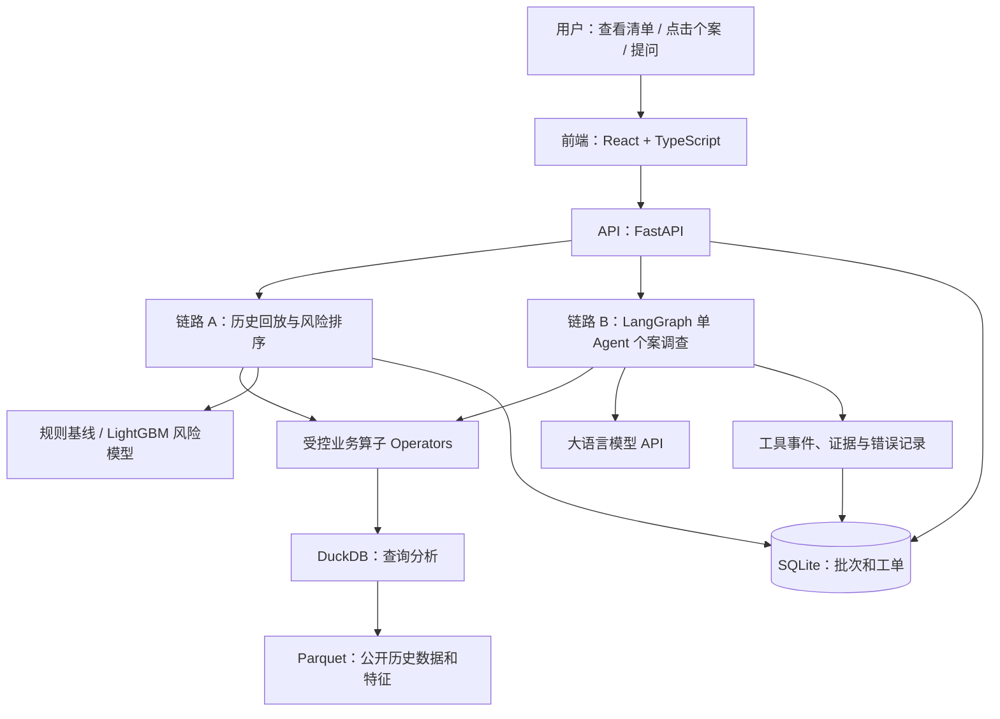
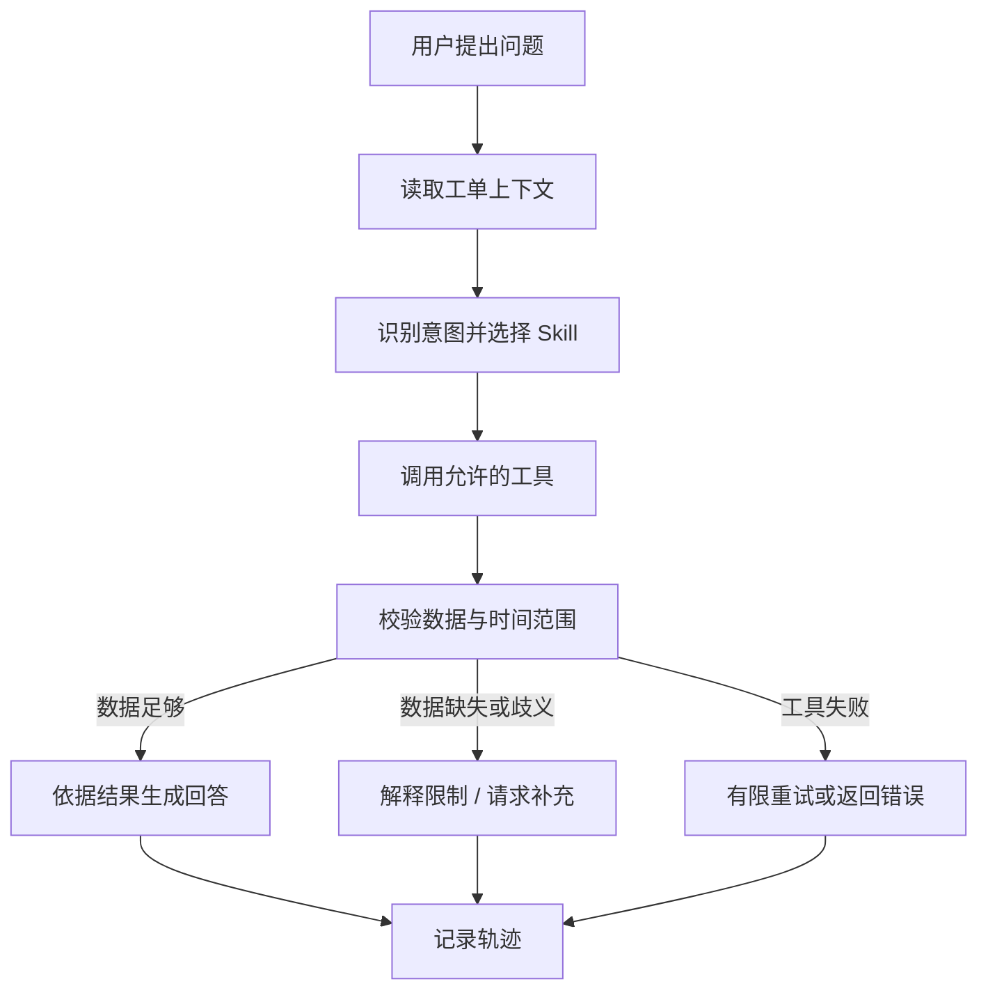

# StockWatch Agent 系统架构详解与排错指南

**版本：** V0.1｜**定位：** 配合《StockWatch Agent 技术设计文档》第 4 节阅读  
**适用对象：** 希望理解模块职责、数据流、排错和后续优化的项目开发者  
**状态：** 教学性设计说明，文中系统尚未实现。所有 ID、时间、记录和日志示例均为虚构，不能当作实际实验结果。

---

## 1. 先理解：系统究竟在解决什么问题？

项目面向生鲜零售的运营人员：每天需要从大量“门店—商品”组合中，挑出次日值得优先检查的对象，并了解它们过去的缺货情况。

我们使用公开的 [FreshRetailNet-50K 数据集](https://huggingface.co/datasets/Dingdong-Inc/FreshRetailNet-50K)，以历史回放的方式模拟工作：假设某天结束后，该天数据已经到达；系统只能使用当日及之前的数据，生成次日的风险排序。之后才使用次日真实记录评测。

要分清三件事：

1. **排序**：从很多门店—商品中挑出最值得检查的，主要由规则或预测模型完成。
2. **调查**：用户选中某一条记录后，查询历史、比较数据并组织回答，由 Agent 工作流和工具协作完成。
3. **处理记录**：用户把某条记录标为“已查看”等，系统保存这个操作。它是我们自己的回放记录，不是原数据中的真实门店处理结果。

这个数据集没有完整的实时库存数量、采购单、供应商交期和真实干预结果。因此 V1 不能声称知道真实缺货原因、应补货数量或由系统带来的业务收益。销量字段经过归一化，不直接等于卖出多少件或多少钱。

### 一句话概括系统

> 用真实历史数据生成巡检清单；针对用户选择的个案，Agent 调用受控工具查证并解释；所有结果保留时间范围、来源和版本，供用户核查。

---

## 2. 整体地图：先看模块如何相连



箭头表示“谁向谁请求能力或者读取信息”，并不意味着所有模块都是独立服务器。**第一版可以在同一台电脑上运行**：前端是一个程序，FastAPI 是一个程序；后端中的 Agent、工具、DuckDB 和模型代码可以位于同一个 Python 项目。

| 模块 | 主要职责 | 一个简单例子 |
|---|---|---|
| 前端 | 让用户查看和操作 | 显示风险列表和提问输入框 |
| FastAPI | 接收请求、校验参数、调用后端逻辑、返回结果 | 接到“查看 case-001”的请求 |
| 排序工作流 | 依据历史特征生成次日清单 | 按近 7 天缺货频次排序 |
| 风险模型 | 对每个对象打分 | LightGBM 输出一个风险分数 |
| Agent 工作流 | 处理个案提问并组织工具调用 | 查缺货历史，再生成解释 |
| LLM API | 理解自然语言、选择工具、生成文字 | 把“最近一周缺货几天”转成工具请求 |
| Operator | 执行一个受限、可验证的操作 | 查询某门店某商品的缺货历史 |
| Skill | 定义某类业务问题的处理流程 | `inspect_case` 规定查什么、如何回答 |
| Parquet | 以文件形式保存表格数据 | 保存历史销售和缺货记录 |
| DuckDB | 查询和聚合表格数据 | 计算指定 7 天的缺货天数 |
| SQLite | 保存产品自己的业务记录 | 保存批次、工单状态、工具事件 |
| 评测与日志 | 检查结果并定位问题 | 查找时间泄漏或工具调用错误 |

你可能注意到：**Parquet 是数据文件格式；DuckDB 是查询引擎；SQLite 是另一个数据库。** 它们不是三个功能完全相同的产品。下面会分开讲。

---

## 3. 用一个例子贯穿全局

假设我们让系统回放到 **2024-05-10 日终**。按照项目约定：

```text
历史数据可见到：2024-05-10（包含当天）
生成风险清单：预测 2024-05-11 的缺货风险
评测标签揭示：等生成清单后，才查看 2024-05-11 的记录
```

假设运营人员在页面看到一条风险记录，点击它并问：

> “这条记录最近 7 天有几天发生过缺货？列出日期。”

一次完整处理经过：

1. 前端把 `case_id` 和问题发给 FastAPI。
2. FastAPI 查找工单，获取它对应的门店、商品与回放日期。
3. Agent 根据问题选择“调查个案”的 Skill。
4. Agent 调用 `get_stockout_history`：请求该对象在 2024-05-04 至 2024-05-10 的缺货记录。
5. Operator 检查开始、结束时间和工单是否匹配，然后通过 DuckDB 查询 Parquet。
6. Python 根据返回记录计算缺货天数并检查缺失日期，形成证据结果。
7. Agent 根据证据组织回答；系统记录调用、结果引用和运行状态。
8. FastAPI 返回结果，前端展示文字、缺货日期、数据范围和工具轨迹。

如果某一天没有记录，系统要显示“该日期缺失”，不能把它默认为“当天没有缺货”。如果用户问“真正缺货原因是什么”，系统应解释目前数据不足以判断。

### 一次请求大致长什么样？

前端发给后端的内容可以是：

```json
{
  "session_id": "session-001",
  "message": "最近7天有几天发生过缺货？列出日期。"
}
```

请求路径包含 `case_id`：

```text
POST /api/v1/cases/case-001/messages
```

后端先回复 `run_id`，表示任务已创建；前端再查询任务状态与结果。这里的 JSON 是系统之间交换的结构化文本。**它是设计示意，不是已经运行过的接口。**

---

## 4. 前端：用户看到和操作的部分

### 4.1 它是什么？

前端是浏览器中运行的页面。这个项目计划使用 **React + TypeScript**：

- React 帮助我们把页面拆成可复用组件，如列表、图表、对话框。
- TypeScript 是在 JavaScript 基础上增加类型检查的语言，可帮助发现一部分数据形状不匹配的问题。

页面可以拆成三个区域：

1. **风险列表**：回放日期、门店、商品、风险分数和工单状态。
2. **个案详情**：历史缺货、归一化销量、图表和数据质量提示。
3. **Agent 面板**：用户提问、工具调用进度、回答与证据。

### 4.2 它负责什么？

- 接收用户点击和输入；
- 向后端发 HTTP 请求；
- 将后端返回的数据展示为列表、图表和文字；
- 处理加载中、无数据和失败等界面状态；
- 在用户确认后提交工单状态。

前端可以做基本输入检查，但**关键业务校验仍要在后端做**。例如，用户绕过页面直接调用 API 时，后端仍需检查日期和权限边界。

### 4.3 常见问题与排查

**页面没有数据显示：**

1. 打开浏览器开发者工具的 Network 面板，找到相应请求。
2. 如果请求没有发出，检查点击事件和前端状态。
3. 如果请求失败，查看状态码和响应错误，再检查后端日志。
4. 如果请求返回了正确 JSON，但页面为空，检查字段名称和组件渲染。

**图表数字和详情表不一致：**先比较两者使用的 API 响应和时间范围。若后端返回相同但页面不同，检查前端单位、排序和图表映射；若后端响应已经不同，继续排查 API 或算子。

### 4.4 后续怎么优化？

列表加载慢时，先判断是页面渲染慢还是 API 慢；证据表明一次渲染太多行时，可考虑分页或虚拟列表。不要在未定位原因时盲目替换前端框架。

---

## 5. API 层：前端和后端的接口

### 5.1 API 是什么？

API 可以理解成后端公开的“可调用入口”。前端不需要知道查询 Parquet 的实现，只需按约定请求：

```text
GET /api/v1/cases/case-001
```

后端返回这个工单的结构化信息。`GET` 通常用于读取，`POST` 常用于提交创建或操作请求；具体语义以接口设计为准。

### 5.2 FastAPI 负责什么？

FastAPI 是 Python Web 框架。在本项目中，它负责：

1. 接收路径、请求参数和 JSON；
2. 检查参数格式，如日期、K 的范围；
3. 调用排序服务、工单仓库或 Agent 工作流；
4. 将结果转换为约定的 JSON 和 HTTP 状态码；
5. 给错误附上可查询的 `run_id` 或请求 ID。

FastAPI **不是模型，也不自动完成数据分析**。它更像统一入口。数据统计交给算子，风险排序交给排序模块，Agent 编排交给 LangGraph。

### 5.3 一个典型故障

前端提交：

```json
{"as_of_date": "not-a-date", "k": 100}
```

API 参数检查应返回明确的输入错误，而不是让排序程序运行后莫名崩溃。检查响应可帮助你判断：问题出在请求内容、校验规则，还是后续处理。

---

## 6. 数据层：Parquet、DuckDB 和 SQLite 分别做什么？

### 6.1 Parquet：保存历史表格的文件格式

可以把 Parquet 看成一种适合分析的表格文件格式，类似 CSV 都能保存表格，但内部存储组织方式不同。项目用它保存公开数据及由历史数据计算出的特征。

例如，一条原始记录的概念是：

```text
门店 12 | 商品 38 | 日期 T | 该日缺货小时数 | 归一化销量
```

实际字段含义以数据卡及导入后的数据画像为准。项目应保留数据版本和文件校验信息，否则之后更新数据时难以复现旧结果。

**常见问题：**文件不存在、列名变化、日期格式不正确、同一门店—商品—日期出现重复。应在导入阶段检查，而不是让错误一直传到 Agent 报告里。

### 6.2 DuckDB：查询历史数据的引擎

DuckDB 用于读取和分析表格。例如，工具需要查询某门店、某商品、某日期区间的记录：

```text
get_stockout_history
    ↓
后端根据固定的查询模板和已校验的参数
    ↓
DuckDB 从历史 Parquet 中查询
    ↓
返回数据给 Python 算子
```

注意：**LLM 不直接写任意 SQL 并执行。** 它只能提交受限制的工具参数；后端校验后再执行开发者定义的查询。DuckDB 也不是安全沙箱，未来支持不可信数据和多用户时还要加强隔离。[DuckDB 安全说明](https://duckdb.org/docs/preview/operations_manual/securing_duckdb/overview)

### 6.3 SQLite：保存我们系统的业务记录

SQLite 保存的是项目自己产生的记录，例如：

```text
inspection_batch：哪天生成的风险清单、使用哪个模型版本
risk_case：某条待检查对象及其状态
case_event：用户做过什么状态修改
agent_run：某次 Agent 调查的运行状态
tool_event：调用了什么工具、成功还是失败
```

例如，用户点击“已查看”后，后端向 SQLite 追加一条操作记录。刷新页面后，API 仍可从 SQLite 读取状态。

### 6.4 三者怎么区分？

| 问题 | 先看哪里？ |
|---|---|
| 原始历史记录是否存在？ | Parquet 数据及其版本 |
| 为什么查询结果少了一天？ | DuckDB 查询条件、算子参数、数据缺失检查 |
| 用户标记过“已查看”，刷新后消失？ | SQLite 写入、事务、API 返回与前端刷新 |
| 两次回放结果不同？ | 数据版本、时间截面、排序规则、模型版本 |

---

## 7. 工作流 A：历史回放与风险排序

### 7.1 什么叫历史回放？

我们手里有一份已经发生过的历史数据，但为了检查“当时能不能提前发现风险”，要把时间固定在 T 日末，隐藏 T+1 及之后的信息。

```text
T 日及之前：用于生成风险清单
T+1 日：被预测的目标日
T+1 真实结果：只能在生成清单之后揭示，用于评测
```

这不是实时预测。项目假设 T 日日终的数据已完整到达；公开数据并没有保证真实系统当时一定能如此及时地看到数据。

### 7.2 每日排序的处理步骤

**① 数据快照**：按 T 截取合法历史数据，绑定数据版本。

**② 数据质量检查**：识别日期缺失、重复记录和字段异常。

**③ 特征计算**：例如近 7 天中，几天有缺货记录；或近 7 天累计缺货小时数。

**④ 规则或模型打分**：先实现简单规则，再比较机器学习模型。

**⑤ 排序和生成工单**：风险较高的排前面；分数相同采用固定 tie-break（并列排序规则），例如依次按门店 ID、商品 ID 排序。

**⑥ 保存版本**：记录 T、目标日、数据版本、规则或模型版本和 K。

### 7.3 风险模型与大语言模型的区别

| 对比 | 风险模型，例如 LightGBM | 大语言模型，即 LLM |
|---|---|---|
| 主要输入 | 历史统计特征 | 用户问题、工具结果等上下文 |
| 主要输出 | 风险分数 | 文字、结构化意图或工具调用 |
| 本项目负责 | 给大量对象排序 | 调查具体对象并解释证据 |
| 怎样评价 | 排序的 Precision@K、Recall@K 等 | 工具参数、数值、证据和拒答是否正确 |

这两种模型可以独立更换。**增加 LLM 提示词不会自动提高风险模型的排序能力；换一个风险模型也不会自动修复 Agent 引用错数字。**

### 7.4 预测和训练的时间边界

例如评测 5 月 11 日时，5 月 11 日的真实缺货结果不能进特征。更容易忽略的是：训练风险模型时，也不能使用 5 月 11 日或之后的标签，再假装模型在 5 月 10 日已经存在。

所以测试窗口使用在测试开始前训练并冻结的模型。历史更早的日期，只能使用当时可用的规则或相应历史模型。

### 7.5 排序效果差，从哪里排查？

依次比较：

1. **标签对吗？** T+1 有记录吗？缺失是否被错误当成没缺货？
2. **时间对吗？** 特征和训练是否使用了未来信息？
3. **候选集合一样吗？** 模型和基线是否在同一批对象上比较？
4. **特征有用吗？** 近 7 天数据是否完整？近期缺货与次日标签的关系如何？
5. **评测口径对吗？** K 是否固定？零正例日期是否单独标记？
6. **模型本身有问题吗？** 最后才比较模型和参数。

如果简单基线已经很好，且模型并没有稳定超过它，那么保留基线也是合理结果。

---

## 8. 工作流 B：Agent 调查个案

### 8.1 Agent 是什么？

在这个项目中，Agent 指一个能够根据用户请求、当前状态和允许使用的工具，选择下一步操作的程序。它不只是模型本身：它还依赖工作流、工具、状态与校验。

这次使用 **LangGraph 单 Agent 工作流**，把过程划分为可检查的节点：



节点是一个步骤；边表示执行走向；状态是运行时共享的资料，例如 `case_id`、`as_of_date`、工具结果引用与错误信息。LangGraph 支持有状态工作流的编排，但需要我们自己定义规则和验证。[LangGraph 官方概览](https://docs.langchain.com/oss/python/langgraph/overview)

### 8.2 LLM 在哪里参与？

LLM 可以：

- 把用户的“过去一周”理解为需要查询 7 天；
- 从允许的工具中选择 `get_stockout_history`；
- 根据已返回的统计结果生成自然语言回答。

代码负责：

- 确定 `case_id` 对应的门店、商品和 T；
- 校验日期不晚于 T；
- 查询历史并计算具体数值；
- 对照证据检查回答中可核验的字段；
- 在失败或信息不足时返回明确状态。

这是一种职责分工。模型即使返回了看起来合法的工具请求，后端也需要验证；模型即使写出流畅回答，系统也不能因此认为数字正确。

### 8.3 状态和记录的区别

- **Agent 运行状态**：当前走到哪个步骤、已经调用哪些工具、有哪些错误。用于继续或排查这次运行。
- **业务工单状态**：这条记录是否已查看、是否需要跟进。由用户操作并存入 SQLite。
- **证据产物**：具体某个查询返回了什么、覆盖什么时间范围、使用哪个数据版本。

它们都可能需要持久保存，但不是同一种信息。运行状态丢了不应悄悄改变工单处理状态。

### 8.4 为什么先用单 Agent？

先让一个 Agent 调用明确工具，较容易追踪一次请求的失败点。如果未来发现“跨门店对比”和“单店分析”确实需要独立处理，再通过实验比较多 Agent 的收益和成本。多个 Agent 并不自动使数据正确。

---

## 9. Operator、Skill 和模型调用的关系

### 9.1 Operator：一个具体工具

`get_stockout_history` 是一个 Operator。它接受受限参数，返回结果或错误：

```json
{
  "operator": "get_stockout_history",
  "status": "success",
  "as_of_date": "2024-05-10",
  "start_date": "2024-05-04",
  "end_date": "2024-05-10",
  "result_ref": "evidence-001",
  "warnings": []
}
```

工具不只要“能查”，还要说明对象、时间、版本、结果引用和异常。这里的 `evidence-001` 是示例。

| 算子 | 功能 | 一个常见错误 |
|---|---|---|
| `get_case_detail` | 查工单对应的门店、商品、日期 | 工单 ID 不存在 |
| `get_stockout_history` | 查历史缺货记录 | 结束日期晚于 T |
| `get_sales_history` | 查历史归一化销量 | 把数值展示为真实件数 |
| `get_risk_evidence` | 查分数、规则或模型版本及特征事实 | 用当前模型解释旧版本结果 |
| `get_case_history` | 查看人工状态历史 | 把演示系统操作说成企业历史记录 |

### 9.2 Skill：一套业务处理方法

`inspect_case` 不是单个查询，而是：

```text
读取个案 → 查询数据质量 → 查询历史缺货 → 汇总证据 → 回答或说明限制
```

你可以把 Skill 作为有版本的流程配置、代码和说明。它规定需要哪些工具、什么时候停止、如何处理缺失与返回什么。不必一开始引入复杂的插件或多智能体系统。

### 9.3 如果 Agent 回答错了，不能马上改 Prompt

假设用户要查“最近 7 天缺货几天”，但答案错误：

1. 查工单 T 是否正确；
2. 查工具调用的日期是否为 `[T-6, T]`；
3. 查 Operator 返回的记录和缺失标识；
4. 独立计算天数，与证据对照；
5. 如果工具结果正确但回答错误，再检查生成节点和提示词。

每一步都记录输入与输出，才能找到真正出错的位置。

---

## 10. 日志、轨迹和证据：以后怎么找问题？

### 10.1 三者分别是什么？

- **日志（log）**：程序事件，比如某请求失败、花了多久。
- **轨迹（trace）**：一次任务跨多个步骤的关联记录，例如从 API 到 Agent 到工具。
- **证据（evidence/artifact）**：某次实际查询得到的可核查结果，附时间范围和版本。

理想情况下，同一个 `run_id` 能把它们联系起来：

```text
run_id=run-001
  API 接收请求             status=success
  load_context             case_id=case-001
  get_stockout_history     evidence=evidence-001
  validate_evidence        status=success
  compose_answer           status=success
```

这些是虚构日志示意。日志不应保存密钥；也应避免默认记录完整原始数据和不必要的敏感内容。

### 10.2 推荐记录什么？

| 字段 | 用途 |
|---|---|
| `request_id` / `run_id` | 把同一次请求的步骤串起来 |
| `case_id`, `as_of_date` | 知道分析对象和历史时点 |
| `data_version`, `model_version` | 复现时使用相同数据与模型 |
| `operator`, 参数摘要, 状态 | 知道调用了什么、有没有成功 |
| `evidence_ref` | 找到具体查询结果 |
| 耗时和错误码 | 判断性能瓶颈及故障类型 |

调试时保留足够信息，但不要以“便于排错”为理由把所有数据都发给 LLM 或写入日志。外部模型调用需明确告知用户发送了哪些信息。

---

## 11. 实际排错案例：从现象定位到模块

### 案例 A：风险清单里出现了不应该参与的日期

**现象：**回放 T 日时，发现某条特征使用了 T+1 的缺货小时数。

**优先检查：**快照构建 → 特征窗口 → 训练数据生成 → 模型可用时间。

**修复：**统一截止日期约束；特征与标签分开存放；训练时也限定可见标签日期。

**验证：**保持 T 及以前的数据不变，分别修改 T+1 的记录；T 的特征和风险清单应保持不变。这是时间泄漏的回归测试。

### 案例 B：Agent 说 3 天，原始数据实际只有 2 天

**先查证据链：**

```text
页面显示 3 天
  ↑ 检查 API 答复是不是 3
  ↑ 检查 Agent 引用的 evidence 是不是 3
  ↑ 检查 Operator 结果和日期区间
  ↑ 检查原始记录与缺失日期
```

如果工具本身把缺失日当成缺货日，修算子；如果工具结果为 2 而模型写成 3，修结果生成及数值一致性检查。把这个问题加入固定评测集，避免下次重现。

### 案例 C：工单状态保存后，刷新又变回待处理

**排查路径：**

1. 前端是否真的发送了状态更新请求？
2. 后端是否返回成功；失败时错误是什么？
3. SQLite 中是否写入了事件、工单当前状态是否更新？
4. 刷新后详情 API 读取的是不是同一个 `case_id`？
5. 如果 API 已返回正确状态，前端是否仍使用旧缓存？

这里主要是前端/API/持久化问题，换 LLM 不会解决。

### 案例 D：模型风险预测效果差

**不要先加更多 Agent。** 先检查标签定义、样本覆盖、时间切分，与“昨天缺货优先”等基线在同一候选集对照。再分析哪些门店或历史长度不足的对象表现差，决定要不要改特征、模型或规则。

### 案例 E：Agent 一直在调用工具

检查是否存在“工具失败 → 模型重新调用 → 相同错误”循环。记录错误码和参数，对网络超时等临时故障有限重试；日期无效这类参数错误应修改参数或结束。设置总调用次数和耗时预算，超出后返回失败，不假装完成。

### 案例 F：运行很慢

先分段计时：API 接收、DuckDB 查询、特征计算、模型推理、LLM 请求和前端渲染。若主要耗时在查询，优化查询和扫描范围；若在 LLM，减少无意义调用或缩短必要上下文；若在前端，检查列表渲染。**计时之前不要猜瓶颈。**

---

## 12. 架构以后怎么优化？

优化不等于换更复杂的框架。每次修改遵循：

```text
明确现象 → 收集证据 → 找瓶颈 → 提出假设
    → 只改一项关键因素 → 用同一测试集对照 → 决定保留或回退
```

### 12.1 数据量变大

**现象：**按门店、商品查询历史越来越慢。

先检查是否每次扫描全部文件、是否重复计算同一个窗口。可以考虑按日期或其他合适方式组织数据、缓存经验证的特征、优化受控查询。

**衡量：**同一组查询的耗时分布、读取数据量、结果一致性。数据组织调整后必须重跑时间边界测试。

### 12.2 排序效果不够好

可以先尝试不同历史窗口、数据缺失处理或简单特征，再考虑更复杂模型。

**衡量：**在同一测试日期、候选集合和 K 下比较规则与模型的 Precision@K、Recall@K 和覆盖率；测试集不能反复调参。风险模型结果不等于真实干预后的收益。

### 12.3 Agent 回答不稳定

先按错误类别划分：意图识别、工具选择、日期参数、算子结果、数字引用、无证据推断。针对占比高的问题改工具描述、输入校验或回答检查，再用固定任务集回测。

**衡量：**工具参数正确率、数字正确率、证据支持率、无数据时拒答率及每类样本数量。不能只看一两个演示案例。

### 12.4 模型调用太贵或慢

先检查是否对每个门店—商品都调用了 LLM。这个架构只在用户调查个案时调用；批量排序不依赖 LLM。也可以控制对话历史长度、减少重复查询，但要检查结果质量和可追溯性是否下降。

**衡量：**同一任务的工具次数、token、调用成本、时延与回答质量。

### 12.5 用户反馈找不到重点

这是产品与交互问题。可以调查他们需要先看到风险分数、缺货时段还是数据质量，再调整页面顺序。没有真实用户时，先把它列为假设，不能直接宣称“节省人工时间”。

### 12.6 需要多人使用或长期运行

SQLite 和单机后台任务可用于原型。确实出现多人并发、进程失败恢复、权限管理需求后，再研究 PostgreSQL、队列、认证和审计。迁移要说明：哪些表、任务状态和工单事件要保留，如何验证迁移前后记录一致。不要把原型称作已具备生产级隔离。

---

### 12.7 真实开发中如何增加一个功能？

假设运营人员想问：“这个商品最近七天通常在哪些小时缺货？”下面是一条可执行的变更路线，说明如何让各层配合：

1. **定义口径**：以工单的 T 为截止，只统计 `[T-6,T]` 范围；检查小时状态的编码、营业时间和缺失天数，不提前猜测 0/1 含义。
2. **写 Operator**：实现 `summarize_hourly_pattern(case_id, start, end)`，返回各小时缺货次数、有效观察天数和证据版本。
3. **先测试算子**：用很小的人工构造数据验证统计、缺失、时间越界；这类小样例用于测试代码，不冒充真实业务评测数据。
4. **接入 Skill**：让 `inspect_case` 在用户提问合适时选择该算子；参数依旧由后端检查。
5. **验证 Agent**：用真实历史记录构造问题，对比工具结果和回答，检查是否正确说明日期范围和数据缺口。
6. **扩展 API 与前端**：把结果作为现有查询或产物输出，在详情页绘制图表；对空数据有提示。
7. **回归与记录**：重跑已有测试，记录改动前后的指标、代码和 Skill 版本；若回答质量恶化，继续排查或回退。

这个功能涉及数据查询、工具、Agent 和页面，但每一层都有明确职责；无需因为增加了一个统计问题，就立即引入多 Agent。

### 12.8 为什么要关联这些 ID？

```text
dataset_version（哪份历史数据）
    ↓
batch_id（哪一天、哪版模型、取多少条）
    ↓
case_id（哪家门店、哪个商品、当时排第几）
    ↓
run_id（针对这个个案的哪次提问）
    ↓
tool_event / evidence_ref（调用什么、引用哪份结果）
```

例如用户反馈“昨天某条回答不对”，你可以沿 ID 找到当时使用的批次、T、模型版本及工具证据，而不必用今天的数据重新猜测。当用户切换历史日期时，应切换或重新创建对应批次，不能让新日期沿用旧 case 的上下文。

---

## 13. 修改哪个模块？一张定位表

| 你看到的现象 | 优先检查 | 可能的调整 | 如何验证 |
|---|---|---|---|
| 风险列表为空 | 批次状态、候选集和日期范围 | 修复数据导入或筛选条件；清楚展示无数据原因 | 核对候选数量与批次执行日志 |
| 原始数据缺少某一天 | 导入与数据质量 | 明确缺失/排除策略 | 缺失率与样本覆盖统计 |
| 预测时使用了次日信息 | 快照、特征、训练切分 | 限制时点并冻结模型 | 修改未来数据不影响当前结果 |
| 风险排序效果差 | 标签、基线、特征和模型 | 改规则或建模方式 | 同候选集比较 Precision@K |
| 工具查错门店 | Agent 参数、工具校验 | 强化工单上下文与参数检查 | 固定多门店任务回归 |
| 工具数字正确，回答数字错误 | 生成和证据检查 | 结构化回答、数值一致性校验 | 数值与证据的逐项对照 |
| 不能判断原因却说“供应商延迟” | 数据边界、生成节点 | 无依据拒答与明确限制 | 无因果证据任务集 |
| 工单状态没有保存 | 状态 API、SQLite、前端 | 修事务、读取或缓存 | 保存后刷新及重启测试 |
| 同一日期出现重复工单 | 批次幂等键、唯一约束与事务 | 复用相同配置批次，避免重复写入 | 重复提交与中断重试测试 |
| 页面加载慢 | 各层耗时 | 针对实测瓶颈优化 | 相同任务的分段耗时 |

---

## 14. 建议怎样学习和动手？

你不需要先把所有知识学完再开始。按“一个模块 + 一个可观察结果”推进：

1. **先认识数据**：读取公开数据的一小部分，理解门店、商品、日期、缺货字段，做数据质量报告。目标是能说明某条记录代表什么。
2. **做时间快照**：输入 T，返回不晚于 T 的记录；写测试证明未来数据不会影响结果。
3. **做规则排序**：实现近 7 日缺货频次，固定并列规则；用次日标签做简单回放。
4. **做受控 Operator**：给定 case 和日期，返回历史证据，覆盖无数据和日期越界。
5. **做 FastAPI**：给已有能力做接口；用固定返回先理解请求和响应。
6. **做最小页面**：显示列表和详情，能看到失败提示。
7. **加 LangGraph 和 LLM**：先只支持一个 Skill、两个只读工具；确认每次工具参数、证据和回答能追踪。
8. **加模型及评测**：冻结时间切分，比较规则和候选模型，再单独评测 Agent。

你可以一边用 AI 辅助编程，一边要求自己解释每个模块的输入、输出、边界和一类失败情况。看不懂的模块不要直接写进简历。

---

## 15. 自测：如果能回答这些问题，说明已经理解架构

1. 为什么全量风险排序不需要对每条数据都调用大语言模型？
2. React、FastAPI、DuckDB 各自接收什么、返回什么？
3. Parquet、DuckDB 和 SQLite 在这个项目中的区别是什么？
4. 用户问个案问题时，LLM 和 Operator 各自负责什么？
5. Skill 与 Operator 有什么不同？
6. 选择 5 月 10 日回放时，为什么不能使用 5 月 11 日的缺货状态？训练模型时还需要防止什么泄漏？
7. 为什么近 7 天缺货多不能直接证明供应商导致缺货？
8. 页面数字错误时，如何沿 API、Agent、工具、数据逐层排查？
9. 规则排序比复杂模型更好时，为什么应该考虑保留规则？
10. 为什么我们不能根据这个公开数据声称建议减少了多少真实损失？

## 16. 参考资料

- [FreshRetailNet-50K 官方数据卡](https://huggingface.co/datasets/Dingdong-Inc/FreshRetailNet-50K)
- [FreshRetailNet-50K 论文](https://arxiv.org/abs/2505.16319)
- [LangGraph 架构说明](https://docs.langchain.com/oss/python/langgraph/overview)
- [DuckDB 安全说明](https://duckdb.org/docs/preview/operations_manual/securing_duckdb/overview)

本文中的架构为学习和实现规划，模块尚未建设；实际开发时应以数据审计结果、测试和实验更新设计。
