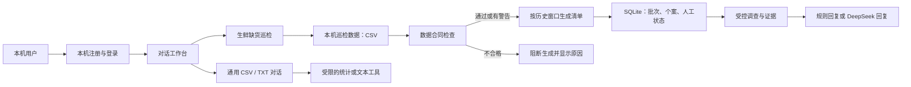

# StockWatch：架构现状、差距与实施路线

版本：2026-11-10。本文件记录本机 Python 版本的实际情况和后续路线。项目聚焦**生鲜零售缺货巡检**：根据历史数据筛选值得人工查看的门店与商品，用证据辅助调查。当前是历史回放原型，还不能据此声称已在真实企业生产环境落地。

## 一、目前系统实际在做什么

生鲜巡检和通用对话是目前两条不同的处理路径。通用对话上传的文件不会自动成为巡检数据；巡检合同也不自动验证通用上传文件。对话文字目前保存在当前浏览器，而不是服务端数据库。

| 模块 | 已有实现 | 关键边界 |
| --- | --- | --- |
| 登录 | 本机 SQLite 账号、会话与测试期管理员限制 | 不具备企业账号管理、找回密码或线上多租户能力 |
| 生鲜数据 | 固定的公开真实历史样本、本机 CSV、数据合同检查 | 没有真实门店的数据对接、数据集版本管理和人工映射流程 |
| 风险清单 | 最近七天规则排序、冻结的逻辑回归测试模型 | 分数不能当成可靠概率；不能凭现有数据确定根因或补货量 |
| Agent | 固定调查流程；模型可使用少量受控只读工具；本机巡检对话已具备基础运行记录 | 尚无统一的技能注册、逐次工具参数和结果记录、完整结果核验机制；通用对话未接入运行记录 |
| 用户操作 | 批次、个案和人工状态保存在本地 SQLite | 没有完整人员分配、通知和业务系统回写闭环 |
| 测试与评测 | 固定数据合同、离线金标和自动测试 | 大模型工具选择、回答事实性和真实业务收益未充分评测 |

## 二、第一步：让合同进入实际业务路径

原先数据合同只由命令行和离线评测调用；数据错误时，页面生成批次未必执行同一套检查。第一步把它接入本机生鲜巡检：生成批次前检查字段、日期、主键、数值范围等，并将不可接受的错误作为阻断条件。缺失值和参考样本不同等警告需要展示，由使用者判断；它们本身不等于错误。合同只验证其声明的静态规则，不能证明源数据在回放日已经可用、字段含义符合真实业务，或决策结果正确。

本步涉及的代码：`backend/app/data_contract.py` 负责检查，`backend/app/services.py` 负责把检查接到批次生成，`backend/app/main.py` 对外提供结果，前端的生鲜巡检区域负责展示。离线评测仍然使用固定样本与独立临时数据库。

## 三、后续按模块推进

### 2. 数据接入与版本管理

让用户导入实际符合约定的生鲜数据：查看字段、映射到标准字段、识别时间和单位、检查数据质量、确认后生成不可变数据版本。每次批次应引用具体版本，而不是依赖随时可能改变的本地 CSV。需要保存来源、导入时间、文件摘要、合同版本和检查结果。先使用明确的手动导入流程，再考虑连接数据库或定时同步。

完成标志：重新启动后仍能查看数据版本；每个批次能回溯输入版本；改变或删除原始文件不会悄悄改变已完成批次的结论。

### 3. 算子、技能和工作流

把业务计算拆成有明确定义的算子，例如缺货历史、趋势、数据覆盖度与候选排序；定义输入、输出、错误和版本。技能把多个算子组合成业务步骤，例如“调查一个缺货个案”；工作流负责步骤顺序、状态和失败处理。模型负责理解问题和选择允许的工具，数值结果由确定性代码计算。

完成标志：同一数据版本和参数下，算子结果可复现；每个技能可单独运行和测试；失败时能定位到具体步骤。

### 4. 运行记录、证据与回答核验

本机巡检对话已保存每次运行的 ID、状态、事件顺序、工具名、耗时和错误类别，详见 [Harness 运行记录设计](Harness-运行记录设计.md)。当前出于最小化记录原则没有保存用户输入、工具参数、工具结果和模型回答；后续需先设计隐私与保留策略，再决定如何保存足以复现的证据。多次调用同一个工具应分别保留，避免证据被覆盖。展示回答依据和数据缺失情况；对可自动检查的数字做一致性校验，对无法确认的结论明确表示不确定。

完成标志：能从回答定位到工具调用和数据版本；工具失败时不伪造证据；同名工具的多次调用均可追溯。

### 5. 业务闭环和持久化

逐步增加工单分派、处理记录、备注、确认与关闭、权限控制以及数据保留策略。先让人工确认形成可追踪闭环，再根据真实业务授权考虑通知或业务系统回写。对话记录、分析任务和证据应有服务端持久化与备份策略。

完成标志：可以回答“谁在什么时间查看、依据什么处理了哪条记录”；系统重启后记录仍可查看。

### 6. 评测和交付准备

在固定真实历史数据基础上扩充经人工复核的问题和证据，分别评测数据质量、排序回放、工具选择、参数、答案事实性和拒答边界；区分确定性离线测试与真实模型测试。上线前再补充成本、权限、并发、备份、故障恢复、敏感数据处理与部署设计。

完成标志：每次修改能对照版本化基线复跑，报告通过、失败与未评测项；真实业务效果需在取得业务反馈后单独验证。

## 四、如何排查问题

1. 清单没生成：先检查数据合同报告、回放日期和数据源，再看批次接口错误；合同错误应先修复数据，而不是让模型猜测。
2. 排序不合理：检查使用的日期窗口、缺失记录、排序方法和数据版本；规则分数是历史比例，不是概率。
3. 回答不可信：核对工具返回的证据、时间范围及缺失情况；模型文本本身不是数据证据。
4. 找不到对话：当前浏览器记录与本机账号绑定在浏览器本地，换浏览器、清除浏览数据或更换账号不会自动同步。

每完成一步，都应更新本文件的现状和边界，并运行相应测试；后续方案根据真实数据和使用反馈调整。
